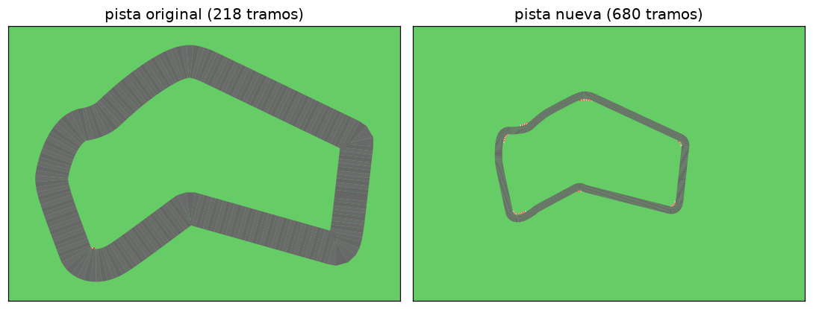
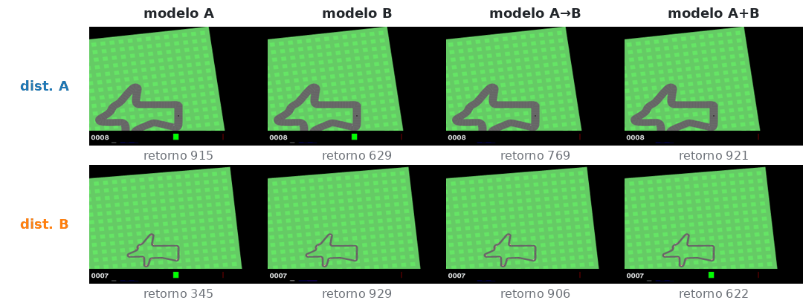
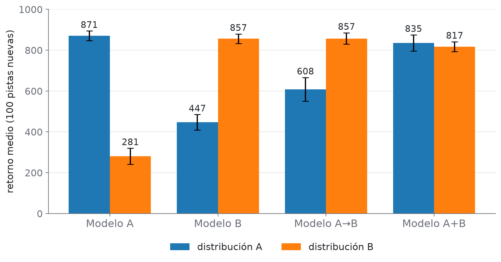
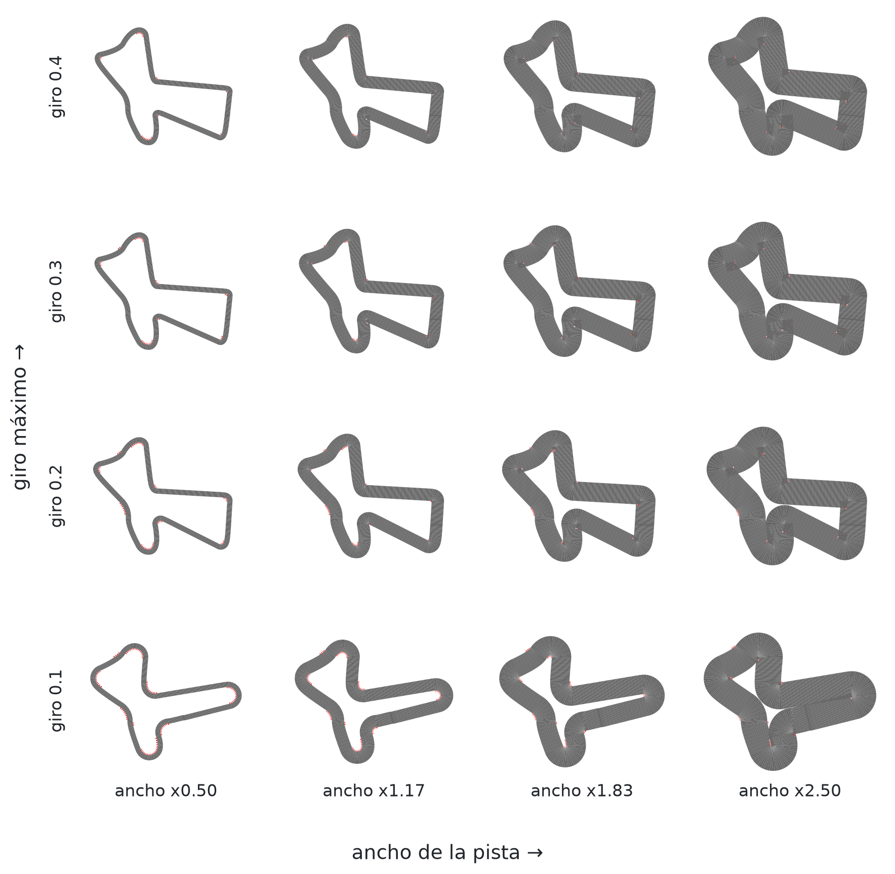
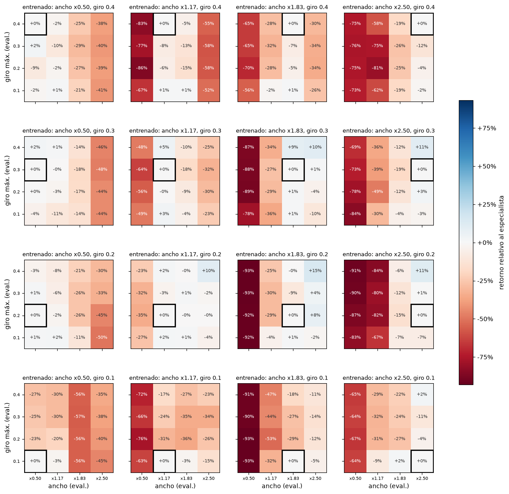
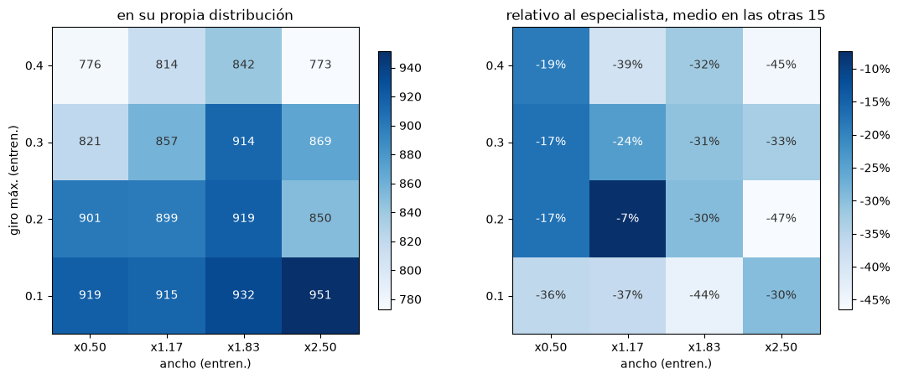

# Robustez de PPO en CarRacing ante un cambio de distribución

**Transfer learning entre distribuciones de pista.** Entrenamos PPO en una distribución de pistas de `CarRacing-v3` (fuente, A) y medimos cuánto rinde en otra (destino, B). Para averiguar cuánto se transfiere de A a B.



- **A (original):** pistas anchas y grandes.
- **B (nueva):** pistas angostas y más chicas.

## Modelos

| Modelo | En el código | Entrena en |
|-|-|-|
| A | `base` | A (en B es zero-shot) |
| B | `scratch` | B, desde cero |
| A→B | `finetune` | A y después fine-tune en B |
| A+B | `mix` | mezcla 50/50 de A y B |

Todos usan la misma red (CNN) y los mismos hiperparámetros.



## Resultados




- **Transferencia directa:** el modelo A pierde 68 % de su retorno en B. El modelo B pierde 48 % en A.
- **Fine-tune:** A→B aprende B, pero olvida parte de A.
- **Mezcla:** A+B rinde bien en las dos.

## ¿Entre qué distribuciones se transfiere bien?

Variamos el ancho y el giro máximode la pista. En cada una entrenamos un modelo desde cero (500k steps) y medimos su transferencia directa a las otras 15.



- Cada cuadro es un modelo (borde negro: su distribución fuente). 
- Cada celda es retorno en ese destino, relativo al especialista (el modelo entrenado en ese destino). 
- Azul: mejor que el especialista. 
- Rojo: peor.





## Cómo correr

Python 3.14, con las dependencias de `requirements.txt`

```
jupyter nbconvert --to notebook --execute --inplace tp_rl.ipynb
```

